<div align="center">
  

  <br />

  <p>
    <a href="https://scottdensmore.com"></a>
    <a href="https://www.linkedin.com/in/scott-densmore-b8a5031a"></a>
  </p>
</div>

##  Hi! I'm Scott

I am a **Senior Director @ Google** working on awesome things! When I'm not working, I love learning new programming languages, rebuilding classic 1970s/1980s arcade and microcomputer systems from scratch, exploring autonomous AI agents, working out, watching movies, spending time with family, or playing video games.

---

##  A Few of My Favorite Things — 3D Holo-Deck

> My favorite classic computers and icons sculpted into **3D models** with perspective projection, directional & specular shading, and animated 3D turntables—alongside downloadable binary `.stl` 3D meshes in [`./models/`](./models/).

<table width="100%">
  <tr>
    <td width="50%" align="center" valign="top">
      
      <br />
       <b>Apple ][ Plus &amp; Dual Disk ][ (1979)</b>
      <br />
      <sub>Where the 6502 journey began—complete with glowing P31 green phosphor CRT, Applesoft BASIC prompt, HIRES graphics, and Dual Disk ][ drives.</sub>
      <br />
      <sub><a href="./models/apple2.stl"> View Interactive 3D Mesh (<code>apple2.stl</code>)</a></sub>
    </td>
    <td width="50%" align="center" valign="top">
      
      <br />
       <b>Commodore 64 &quot;Breadbin&quot; &amp; 1541 Drive (1982)</b>
      <br />
      <sub>The 8-bit legend—featuring the iconic taupe breadbin chassis, side function keys, 1702 monitor with the classic light-blue border &amp; BASIC V2 prompt, 3-voice SID 6581 synth, and 1541 floppy drive.</sub>
      <br />
      <sub><a href="./models/c64.stl"> View Interactive 3D Mesh (<code>c64.stl</code>)</a></sub>
    </td>
  </tr>
  <tr>
    <td width="50%" align="center" valign="top">
      
      <br />
       <b>Apple Macintosh 128K (1984)</b>
      <br />
      <sub>The iconic all-in-one compact Mac with the smiling <i>Happy Mac</i> boot screen, 400K 3.5" microfloppy drive, keyboard, and one-button mouse that sparked decades of building native macOS &amp; iOS apps.</sub>
      <br />
      <sub><a href="./models/macintosh.stl"> View Interactive 3D Mesh (<code>macintosh.stl</code>)</a></sub>
    </td>
    <td width="50%" align="center" valign="top">
      
      <br />
       <b>Commodore Amiga &amp; 1084S Boing Ball (1985)</b>
      <br />
      <sub>Custom coprocessor magic (Agnus, Denise &amp; Paula 4-channel sound)—complete with the sleek Amiga wedge keyboard, two-button &quot;Tank Mouse&quot;, Workbench 1.3, and the bouncing 3D checkered Boing Ball.</sub>
      <br />
      <sub><a href="./models/amiga.stl"> View Interactive 3D Mesh (<code>amiga.stl</code>)</a></sub>
    </td>
  </tr>
  <tr>
    <td width="50%" align="center" valign="top">
      
      <br />
       <b>Incom T-65B X-Wing Starfighter</b>
      <br />
      <sub>Red Five standing by—featuring articulated S-foils locking into attack position, R2 astromech dome, glowing 4L4 fusial thrust engines, and quad KX9 laser cannons.</sub>
      <br />
      <sub><a href="./models/xwing.stl"> View Interactive 3D Mesh (<code>xwing.stl</code>)</a></sub>
    </td>
    <td width="50%" align="center" valign="top">
      
      <br />
       <b>House of El // 3D S-Shield Crest</b>
      <br />
      <sub>Faceted crimson and gold 3D diamond shield with chiseled bevels, raised 3D sculpted crest on both faces, and dynamic specular reflections across a 360° turntable.</sub>
      <br />
      <sub><a href="./models/superman.stl"> View Interactive 3D Mesh (<code>superman.stl</code>)</a></sub>
    </td>
  </tr>
</table>

<details>
  <summary> <b>Toggle Original Retro ASCII Art Terminal</b> (Classic Phosphor View)</summary>
  <br />

```text
    .__________________________.                  ______________
    | .___________________. |==|                 /             /|
    | | ................. | |  |                /             / |
    | | ::::Apple ][::::: | |  |               /____________ /  |
    | | ::::::::::::::::: | |  |              | ___________ |   |
    | | ::::::::::::::::: | |  |              ||           ||   |
    | | ::::::::::::::::: | |  |              ||   HAPPY   ||   |
    | | ::::::::::::::::: | |  |              ||    MAC    ||   |
    | | ::::::::::::::::: | | ,|              ||___________||   |
    | !___________________! |(c|              |   _______   |  /
    !_______________________!__!             /|  (_______)  | /
   /                            \           ( |_____________|/
  /  [][][][][][][][][][][][][]  \           \
 /  [][][][][][][][][][][][][][]  \      .=======================.
(  [][][][][____________][][][][]  )     | ::::::::::::::::  ::: |
 \ ------------------------------ /      | ::::::::::::::[]  ::: |
  \______________________________/       `-----------------------'

   .----------------------------.        .------------------------------.
   |  .----------------------.  |        |  .------------------------.  |
   |  | **** C64 BASIC V2 ** |  |        |  | AMIGA WORKBENCH    [X] |  |
   |  | 64K RAM SYSTEM       |  |        |  |       _.-""""-._       |  |
   |  | READY.               |  |        |  |     .'  #    #  '.     |  |
   |  | LOAD"*",8,1          |  |        |  |    /  #   ##   #  \    |  |
   |  | _                    |  |        |  |    |    ##  ##    |    |  |
   |  '----------------------'  |        |  |     '._  #  #  _.'     |  |
   '----------------------------'        '------------------------------'
  / C= COMMODORE 64          [*] \      / /// AMIGA            [P][D]   \
 / [][][][][][][][][][][][] [F1]  \    / [F1][F2][F3][F4][F5] [F6]..[F10]\
(  [][][][][__________][][] [F5]   )  (  [][][][][__________][][]  [NUM]  )
 \_______________________________/    \__________________________________/

.-.__      \ .-.  ___  __                  _____________________________________________
|_|  '--.-.-(   \/\;;\_\.-._______.-.    //:::::::::::::::::::::::::::::::::::::::::::::\\
(-)___     \ \ .-\ \;;\(   \       \ \  //:::_______:::::::::________::::::::::_____::::::\\
 Y    '---._\_((Q)) \;;\\ .-\     __(_)//:::_/   _-"":::_--"""        """--_::::\_  ):::::::\\
 I           __'-' / .--.((Q))---'    \,:::/    /:::::_"                    "-_:::\/:::::|^\::\\
 I     ___.-:    \|  |   \'-'_          \:/   /~::::::I__                      \:::::::::|  \::\\
 A  .-'      \ .-.\   \   \ \ '--.__     '\   (::::::::::""""---___________     "--------"  /::/
 |  |____.----((Q))\   \__|--\_      \     '  |::::::::::::::::::::::::::::""""==____      /::/
    ( )        '-'  \_  :  \-' '--.___\       "\/::::::::::::::::::::::::::::::::::::::\   /~::/
     Y                \  \  \       \(_)        \\::::::::::::::::::::::::::::::::::::::)/~::/
     I                 \  \  \         \,         \\::::\""""""------_____::::::::::::::::::/
     I                  \  \  \          \          \\:::"\               """""-----_____::/
     A                   \  \  \          '\          \\:::"\    __----__                ):/
     |                    \  \__|           '           \\:::"\/~::::::::~\_         __/~:/
                           \_:.  \                        \\::::::::::::::::""----""":::/
                             \ \  \                         \\::::::::::::::::::::::::/
                              \ \  \                          \\:::\^""--._.--""^/::/
                               \_\_|                            \\::"\         /":/
                                                                  \\::"\_/":/
                                                                    \\_//
```
</details>

---

##  Programming Languages &amp; Polyglot Stack

<div align="center">
  
</div>

| Domain | Languages &amp; Runtimes | Focus Areas |
| :--- | :--- | :--- |
|  **Systems &amp; Retro Emulation** | `C++` · `Rust` · `Go` · `C` · `6502 BASIC` | Cycle-accurate arcade &amp; home computer hardware, real-time audio synthesis (SID / Paula / POKEY / AY-8910), Ebitengine &amp; Macroquad |
|  **Apple Platforms** | `Swift` · `SwiftUI` · `Objective-C` | Native macOS, iOS, iPadOS, watchOS &amp; visionOS apps, SwiftData, HealthKit |
|  **AI Agents, Cloud &amp; Web** | `Go` · `TypeScript` · `C#` · `Python` · `Ruby` | Autonomous Gemini agents, A2A protocol, Three.js / WebGL, Next.js, GCP |

---

##  Bookshelf

<table width="100%">
  <tr>
    <th width="45%" align="left"> Sci-Fi &amp; Worldbuilding</th>
    <th width="55%" align="left"> Engineering, Culture &amp; Leadership</th>
  </tr>
  <tr>
    <td valign="top">
      <p>
         <a href="https://en.wikipedia.org/wiki/The_Kingkiller_Chronicle"><b>The Kingkiller Chronicle</b></a> — <i>Patrick Rothfuss</i><br />
         <a href="https://en.wikipedia.org/wiki/Dune_(franchise)"><b>Dune</b></a> — <i>Frank Herbert</i>
      </p>
    </td>
    <td valign="top">
      <p>
         <a href="https://www.amazon.com/Tribal-Leadership-Leveraging-Thriving-Organization/dp/B002G89SV6"><b>Tribal Leadership</b></a> — <i>Dave Logan, John King &amp; Halee Fischer-Wright</i><br />
         <a href="https://www.amazon.com/Radical-Candor-Kick-Ass-Without-Humanity/dp/1250103509"><b>Radical Candor</b></a> — <i>Kim Scott</i><br />
         <a href="https://www.amazon.com/Accelerate-Software-Performing-Technology-Organizations-ebook/dp/B07B9F83WM"><b>Accelerate</b></a> — <i>Nicole Forsgren, Jez Humble &amp; Gene Kim</i><br />
         <a href="https://www.amazon.com/Lean-Startup-Entrepreneurs-Continuous-Innovation/dp/0670921602"><b>The Lean Startup</b></a> — <i>Eric Ries</i><br />
         <a href="https://www.amazon.com/Phoenix-Project-DevOps-Helping-Business/dp/1942788290"><b>The Phoenix Project</b></a> — <i>Gene Kim, Kevin Behr &amp; George Spafford</i><br />
         <a href="https://www.amazon.com/Subscribed-Subscription-Model-Companys-Future/dp/0241363667"><b>Subscribed</b></a> — <i>Tien Tzuo &amp; Gabe Weisert</i>
      </p>
    </td>
  </tr>
</table>
