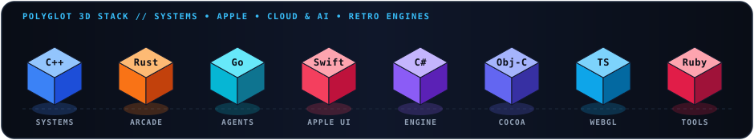

<div align="center">
  

  <br />

  <p>
    <a href="https://scottdensmore.com"></a>
    <a href="https://www.linkedin.com/in/scott-densmore-b8a5031a"></a>
    <a href="https://github.com/scottdensmore?tab=repositories"></a>
  </p>
</div>

## 👋 Hi! I'm Scott

I am a **Senior Director @ Google** working on awesome things! When I'm not working, I love learning new programming languages, rebuilding classic 1970s/1980s arcade and microcomputer systems from scratch, exploring autonomous AI agents, working out, watching movies, spending time with family, or playing video games.

---

## ✨ A Few of My Favorite Things — 3D Holo-Deck

> Each of my classic ASCII art favorites has been sculpted into a **3D model** with perspective projection, directional & specular shading, and animated 3D turntables—alongside downloadable binary `.stl` 3D meshes in [`./models/`](./models/).

<table width="100%">
  <tr>
    <td width="50%" align="center" valign="top">
      
      <br />
      <b>🟢 Apple ][ Plus &amp; Dual Disk ][ (1979)</b>
      <br />
      <sub>Where the 6502 journey began—complete with glowing P31 green phosphor CRT, Applesoft BASIC prompt, HIRES graphics, and Dual Disk ][ drives. Powers the inspiration behind <a href="https://github.com/scottdensmore/go-basic"><code>go-basic</code></a>.</sub>
      <br />
      <sub><a href="./models/apple2.stl">🧊 View Interactive 3D Mesh (<code>apple2.stl</code>)</a></sub>
    </td>
    <td width="50%" align="center" valign="top">
      
      <br />
      <b>🔵 Apple Macintosh 128K (1984)</b>
      <br />
      <sub>The iconic all-in-one compact Mac with the smiling <i>Happy Mac</i> boot screen, 400K 3.5" microfloppy drive, keyboard, and one-button mouse that sparked decades of building native macOS &amp; iOS apps.</sub>
      <br />
      <sub><a href="./models/macintosh.stl">🧊 View Interactive 3D Mesh (<code>macintosh.stl</code>)</a></sub>
    </td>
  </tr>
  <tr>
    <td width="50%" align="center" valign="top">
      
      <br />
      <b>🔴 Incom T-65B X-Wing Starfighter</b>
      <br />
      <sub>Red Five standing by—featuring articulated S-foils locking into attack position, R2 astromech dome, glowing 4L4 fusial thrust engines, and quad KX9 laser cannons.</sub>
      <br />
      <sub><a href="./models/xwing.stl">🧊 View Interactive 3D Mesh (<code>xwing.stl</code>)</a></sub>
    </td>
    <td width="50%" align="center" valign="top">
      
      <br />
      <b>🟡 House of El // 3D S-Shield Crest</b>
      <br />
      <sub>Faceted crimson and gold 3D diamond shield with chiseled bevels, raised 3D sculpted crest on both faces, and dynamic specular reflections across a 360° turntable.</sub>
      <br />
      <sub><a href="./models/superman.stl">🧊 View Interactive 3D Mesh (<code>superman.stl</code>)</a></sub>
    </td>
  </tr>
</table>

<details>
  <summary>📟 <b>Toggle Original Retro ASCII Art Terminal</b> (Classic Phosphor View)</summary>
  <br />

```text
    .__________________________.                  ______________
    | .___________________. |==|                 /             /|
    | | ................. | |  |                /             / |
    | | ::::Apple ][::::: | |  |               /____________ /  |
    | | ::::::::::::::::: | |  |              | ___________ |   |
    | | ::::::::::::::::: | |  |              ||           ||   |
    | | ::::::::::::::::: | |  |              ||   HAPPY   ||   |
    | | ::::::::::::::::: | |  |              ||    MAC    ||   |
    | | ::::::::::::::::: | | ,|              ||___________||   |
    | !___________________! |(c|              |   _______   |  /
    !_______________________!__!             /|  (_______)  | /
   /                            \           ( |_____________|/
  /  [][][][][][][][][][][][][]  \           \
 /  [][][][][][][][][][][][][][]  \      .=======================.
(  [][][][][____________][][][][]  )     | ::::::::::::::::  ::: |
 \ ------------------------------ /      | ::::::::::::::[]  ::: |
  \______________________________/       `-----------------------'

.-.__      \ .-.  ___  __                  _____________________________________________
|_|  '--.-.-(   \/\;;\_\.-._______.-.    //:::::::::::::::::::::::::::::::::::::::::::::\\
(-)___     \ \ .-\ \;;\(   \       \ \  //:::_______:::::::::________::::::::::_____::::::\\
 Y    '---._\_((Q)) \;;\\ .-\     __(_)//:::_/   _-"":::_--"""        """--_::::\_  ):::::::\\
 I           __'-' / .--.((Q))---'    \,:::/    /:::::_"                    "-_:::\/:::::|^\::\\
 I     ___.-:    \|  |   \'-'_          \:/   /~::::::I__                      \:::::::::|  \::\\
 A  .-'      \ .-.\   \   \ \ '--.__     '\   (::::::::::""""---___________     "--------"  /::/
 |  |____.----((Q))\   \__|--\_      \     '  |::::::::::::::::::::::::::::""""==____      /::/
    ( )        '-'  \_  :  \-' '--.___\       "\/::::::::::::::::::::::::::::::::::::::\   /~::/
     Y                \  \  \       \(_)        \\::::::::::::::::::::::::::::::::::::::)/~::/
     I                 \  \  \         \,         \\::::\""""""------_____::::::::::::::::::/
     I                  \  \  \          \          \\:::"\               """""-----_____::/
     A                   \  \  \          '\          \\:::"\    __----__                ):/
     |                    \  \__|           '           \\:::"\/~::::::::~\_         __/~:/
                           \_:.  \                        \\::::::::::::::::""----""":::/
                             \ \  \                         \\::::::::::::::::::::::::/
                              \ \  \                          \\:::\^""--._.--""^/::/
                               \_\_|                            \\::"\         /":/
                                                                  \\::"\_/":/
                                                                    \\_//
```
</details>

---

## 💖 Programming Languages &amp; Polyglot Stack

<div align="center">
  
</div>

| Domain | Languages &amp; Runtimes | Focus Areas |
| :--- | :--- | :--- |
| **Systems &amp; Retro Emulation** | `C++` · `Rust` · `Go` · `C` · `6502 BASIC` | Cycle-accurate arcade hardware, real-time audio synthesis (POKEY / AY-8910), Ebitengine &amp; Macroquad |
| **Apple Platforms** | `Swift` · `SwiftUI` · `Objective-C` | Native macOS, iOS, iPadOS, watchOS &amp; visionOS apps, SwiftData, HealthKit |
| **AI Agents, Cloud &amp; Web** | `Go` · `TypeScript` · `C#` · `Python` · `Ruby` | Autonomous Gemini agents, A2A protocol, Three.js / WebGL, Next.js, GCP |

---

## 🕹️ Featured Builds &amp; Retro Lab

| Project | Stack | Description |
| :--- | :---: | :--- |
| 🎯 [**missile-command**](https://github.com/scottdensmore/missile-command) | `Rust` `Macroquad` | Authentic 1980 Atari Missile Command arcade replica in Rust with real-time sound synthesis. |
| ☄️ [**asteroids**](https://github.com/scottdensmore/asteroids) | `Go` `Ebitengine` | Vector-style 1979 Asteroids arcade recreation with wrapping physics and saucer AI. |
| 🖖 [**super-star-trek**](https://github.com/scottdensmore/super-star-trek) | `Go` `C` `TUI` | Classic 1978 mainframe tactical strategy game rebuilt for modern terminals and the web. |
| 💾 [**go-basic**](https://github.com/scottdensmore/go-basic) | `Go` `6502 BASIC` | Cross-platform interpreter for classic line-numbered Microsoft 8K BASIC. |
| 🤖 [**agent-no-adk**](https://github.com/scottdensmore/agent-no-adk) | `Go` `Gemini` `A2A` | Autonomous SRE incident triage agent built natively in Go with the A2A protocol and Gemini. |
| 🧠 [**agent-brain-visualizer**](https://github.com/scottdensmore/agent-brain-visualizer) | `Web` `JSONL` | Interactive web visualizer for AI agent execution transcripts and reasoning steps. |
| 🎮 [**gemini-blackops**](https://github.com/scottdensmore/gemini-blackops) | `TypeScript` `Three.js` | 3D first-person shooter built with Three.js &amp; Vite, verified by 500+ Playwright E2E tests. |
| 🧾 [**rcptpixie**](https://github.com/scottdensmore/rcptpixie) | `Go` `Ollama` | Privacy-first CLI that renames PDF receipts and documents using a local LLM. |

---

## 🌈 Bookshelf

<table width="100%">
  <tr>
    <th width="45%" align="left">🪐 Sci-Fi &amp; Worldbuilding</th>
    <th width="55%" align="left">🚀 Engineering, Culture &amp; Leadership</th>
  </tr>
  <tr>
    <td valign="top">
      <ul>
        <li>🌌 <a href="https://en.wikipedia.org/wiki/The_Kingkiller_Chronicle"><b>The Kingkiller Chronicle</b></a> — <i>Patrick Rothfuss</i></li>
        <li>🏜️ <a href="https://en.wikipedia.org/wiki/Dune_(franchise)"><b>Dune</b></a> — <i>Frank Herbert</i></li>
      </ul>
    </td>
    <td valign="top">
      <ul>
        <li>🔥 <a href="https://www.amazon.com/Tribal-Leadership-Leveraging-Thriving-Organization/dp/B002G89SV6"><b>Tribal Leadership</b></a> — <i>Dave Logan, John King &amp; Halee Fischer-Wright</i></li>
        <li>💡 <a href="https://www.amazon.com/Radical-Candor-Kick-Ass-Without-Humanity/dp/1250103509"><b>Radical Candor</b></a> — <i>Kim Scott</i></li>
        <li>⚡ <a href="https://www.amazon.com/Accelerate-Software-Performing-Technology-Organizations-ebook/dp/B07B9F83WM"><b>Accelerate</b></a> — <i>Nicole Forsgren, Jez Humble &amp; Gene Kim</i></li>
        <li>📈 <a href="https://www.amazon.com/Lean-Startup-Entrepreneurs-Continuous-Innovation/dp/0670921602"><b>The Lean Startup</b></a> — <i>Eric Ries</i></li>
        <li>🛠️ <a href="https://www.amazon.com/Phoenix-Project-DevOps-Helping-Business/dp/1942788290"><b>The Phoenix Project</b></a> — <i>Gene Kim, Kevin Behr &amp; George Spafford</i></li>
        <li>🔄 <a href="https://www.amazon.com/Subscribed-Subscription-Model-Companys-Future/dp/0241363667"><b>Subscribed</b></a> — <i>Tien Tzuo &amp; Gabe Weisert</i></li>
      </ul>
    </td>
  </tr>
</table>
